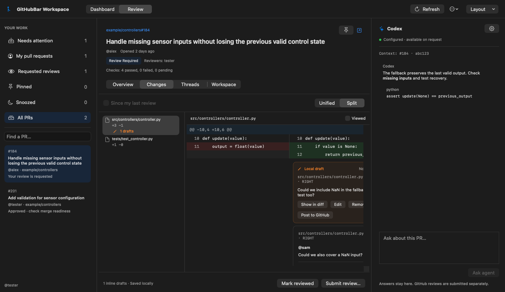
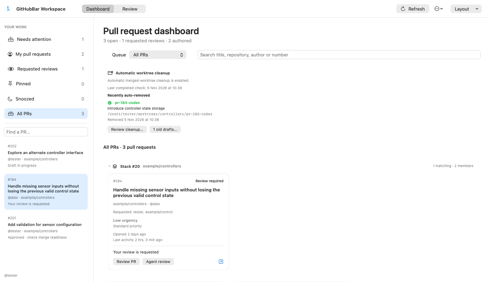
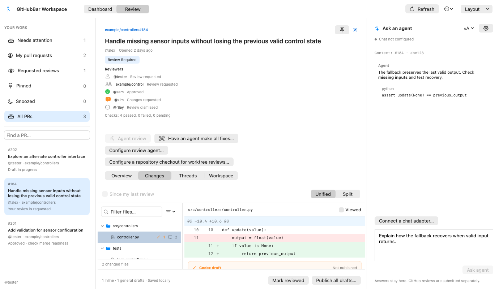
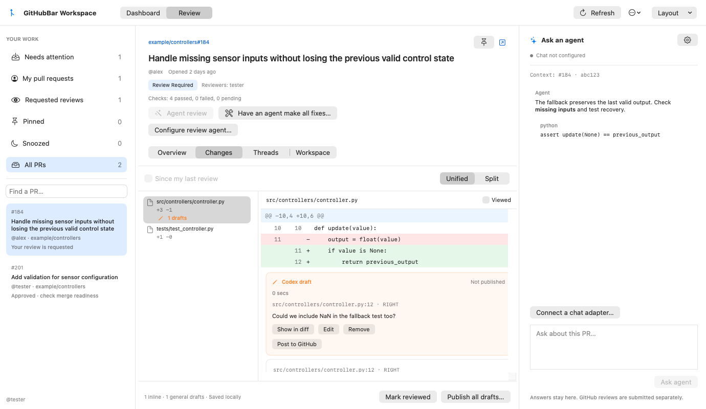
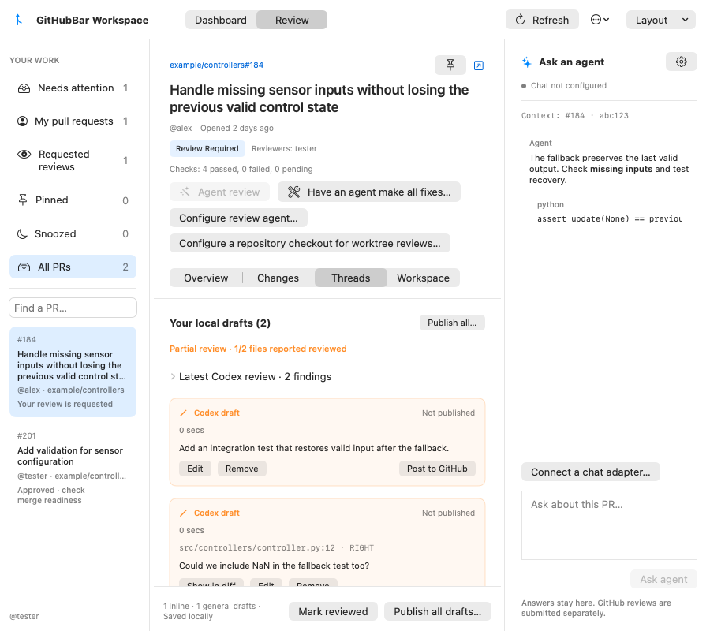
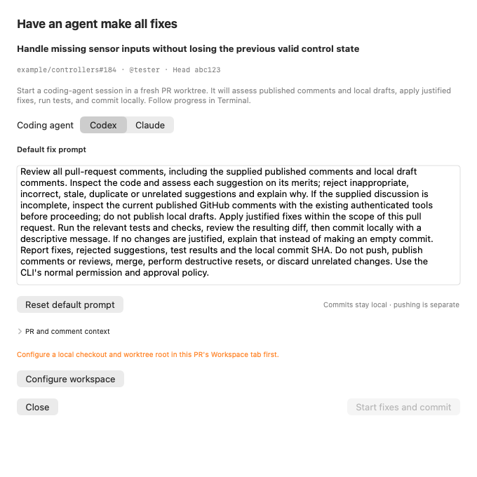

# GitHubBar

**Your pull requests, code reviews, and coding agents in one native Mac workspace.**

[](https://github.com/nikovert/GitHubBar/releases)
[](https://www.swift.org/)

GitHubBar opens its dashboard at launch and stays in the Dock and Cmd+Tab. Keep your
review queue in a persistent menu bar popover. Use the resizable workspace to prioritize PRs,
read diffs, draft and submit reviews, ask an agent questions, and jump into the
terminal session attached to your worktree.

[**Download v0.10.1 for macOS**](https://github.com/nikovert/GitHubBar/releases/download/validation-v0.10.1-1/GitHubBar-validation-0.10.1-aebd68fea0e5.zip) · [SHA-256](https://github.com/nikovert/GitHubBar/releases/download/validation-v0.10.1-1/GitHubBar-validation-0.10.1-aebd68fea0e5.zip.sha256) · [Latest release](https://github.com/nikovert/GitHubBar/releases/latest) · [Build from source](#build-from-source)



*The native review workspace in dark mode. Screenshots use example PR data; the
chat panel shows an example advisory answer.*

> This is a development fork of
> [FranciscoMoretti/GitHubBar](https://github.com/FranciscoMoretti/GitHubBar), with a
> larger management workspace, in-app code review, and local agent integrations.

## Know what needs your attention

- **One place for your PRs and review requests.** Switch between Needs attention,
  My pull requests, Requested reviews, Pinned, Snoozed, and All PRs.
- **Recognize the work immediately.** See titles, authors, requested reviewers,
  review status, age, activity, and the next action alongside each PR.
- **See who has reviewed.** The full reviewer roster keeps requested people and
  teams visible alongside completed reviewers, with ticks for confirmed approvals.
  Approved follows GitHub's aggregate decision or verified approval requirements;
  every requested reviewer does not have to approve.
- **Keep the dashboard current.** Refresh removes merged and closed PRs from the
  active cards. Native GitHub stacks appear as expandable groups; finished members
  remain available as navigation context in PR details.
- **Priorities with a reason.** Set a manual priority, inherit one from a stack,
  or use automatic ranking that favors PRs where you are the sole requested human
  reviewer. Configure priority authors to surface the work that matters to you.
- **Keep your own context.** Add notes and extended status tags to PRs and stacks,
  pin important work, or snooze a PR for 24 hours. Compatible agents can update
  priorities, notes, and status through the bundled workspace CLI.
- **Keep the menu bar useful.** Scan review workflow sections, reviewer avatars,
  and compact PR stacks. Filter to a device-local set of repositories and open the
  menu with <kbd>⌥</kbd><kbd>⌘</kbd><kbd>G</kbd>.
- **Choose your appearance.** Follow macOS or choose Light or Dark in Settings.



*Dashboard in light mode. Activity uses GitHub's update timestamp, which can include bots.*

## Review code inside the app

- **Unified and split diffs** with a GitHub-style folder tree, path filtering,
  viewed markers, and draft/discussion counts beside files. Resize the PR sidebar,
  file list, and chat; hide panels or use **Layout → Focus diff** for more reading
  space. Panel sizes and visibility persist; **Reset layout** restores the defaults.
- **Readable text.** Use <kbd>⌘</kbd><kbd>+</kbd> or <kbd>⌘</kbd><kbd>−</kbd>
  to resize workspace and chat text, and <kbd>⌘</kbd><kbd>0</kbd> to reset.
  The chat header lets you resize messages, code, and the composer together
  without changing workspace text.
- **Overview, Changes, Threads, and Workspace tabs** for the description, checks,
  conversation, code, local notes, and attached sessions.
- **Inline drafts and review submission.** Select a line, save a comment locally,
  then explicitly post that draft or submit a batch Comment, Approval, or Request changes review to GitHub.
- **Review the whole PR in a worktree.** Configure a checkout in Workspace, then
  click **Agent review** with Codex or Claude. It inspects a fresh PR worktree with
  complete patches and surrounding code. Threads shows reported file coverage and
  limitations. Findings stay local until you publish all or individual comments.
- **Fix comments with an agent.** **Have an agent make all fixes…** shows editable
  instructions and starts Codex/Claude in a fresh PR worktree to assess comments,
  apply fixes, test, and commit locally. Follow the session in Terminal.
- **Pick up where you left off.** Mark files viewed, save a local review baseline,
  and use **Since my last review** to inspect subsequent changes.
- **Drafts stay attached to the code you reviewed.** State is scoped to the account,
  PR, head, and base. Earlier drafts remain accessible when the diff changes;
  failed submissions retain them.



<details>
<summary>See unified diffs in light mode</summary>



</details>

Incomplete and binary patches are identified explicitly, with links to GitHub for
missing code. Viewed-file state and review baselines are local to this Mac.

## Ask an agent about the code

Ask “What tests are missing?”, “Explain this change,” or a question about a selected
diff line without switching away from the PR. The agent receives the description,
a bounded diff excerpt, selected-line context, and recent conversation. Answers can
include clickable file/line citations.

In **Settings → Workspace chat**, choose a detected provider for a locally
authenticated Codex or Claude CLI, or connect any command implementing the
[JSON chat protocol](docs/agent-chat.md). CLI presets use the bundled Python adapter
and require Python 3. Chat is optional; the app works without an agent.

Chat renders Markdown and code, supports cancellation and retry, and labels partial
context. Choose Codex, Claude, or a custom adapter in the provider picker; **Test
connection** verifies a response. Chat stays advisory. Publish individual inline
drafts or a batch Comment, Approve, or Request changes review with explicit workspace
controls. Inline-only Comment reviews do not need a summary.

Use **Agent review** to inspect a fresh PR worktree and collect findings as local
drafts. Reported coverage makes partial reviews visible; no excerpt fallback is
used. The review does not request test execution or code changes. Use **Have an
agent make all fixes…** to assess comments and start a fix/test/local-commit session.
Both actions are explicit. See the [review workflow guide](docs/review-workspace.md).





The app no longer starts or polls Giles background review workers. Existing worker
data is retained, and ordinary local terminal sessions remain available.

## Keep worktrees and agent sessions attached to the PR

Create a Codex or Claude worktree/tmux session, or pin an existing session to a PR
or stack. **Jump to session** brings you back to the terminal work for that PR.

After a successful refresh, automatic cleanup removes verified clean managed
worktrees for merged PRs when no session is live. Local changes, ignored files,
extra commits, and incomplete verification prevent automatic removal.

Dashboard's **Recently auto-removed** list shows worktree names, PR titles, full paths,
and removal times. The last completed check is timestamped even when it removes
nothing. Earlier removals remain visible after empty checks and app restarts. If
filesystem removal succeeds but saving session links fails, the removal is shown
with a follow-up warning.

Open **Review cleanup… → Recent cleanup activity** for recorded outcomes and
retention reasons. The cleanup window also offers an automatic-cleanup switch
and lists other configured-repository worktrees for manual approval. Live managed
sessions require explicit approval to stop; unrelated sessions, terminal tabs,
branch refs, notes and drafts stay intact.

**Old drafts on GitHub…** flags your drafts after a configurable 30 days without
GitHub activity, including activity from bots. Select and confirm to close remote
PRs, keeping their remote branches. Local worktrees are offered for separate manual
cleanup; closing a draft does not automatically remove its worktree.

The [agent workspace guide](docs/agent-workspace.md) covers checkout configuration,
terminal sessions, stack inheritance, and updates through `GitHubBarWorkspaceCLI`.

## Find a PR by what it changes

**Search PRs** matches titles, descriptions, changed file paths, and available diff
content. Results show **In your list** first, followed by **Extended results** from
the repositories you select—including open, draft, merged, and closed PRs.

Click a result or menu PR to open it in the workspace. Right-click a PR in the
search results or menu to go directly to GitHub. Search is literal and
case-insensitive; it does not send code to a model. Coverage and progress indicators
show when a scan is incomplete. See the [search guide](docs/pr-search.md).

## Install

GitHubBar requires **macOS 14 or newer** and supports **Apple Silicon and Intel**.

1. Install and sign in to [GitHub CLI](https://cli.github.com/):

   ```sh
   brew install gh
   gh auth login
   ```

2. Download the [v0.10.1 app ZIP](https://github.com/nikovert/GitHubBar/releases/download/validation-v0.10.1-1/GitHubBar-validation-0.10.1-aebd68fea0e5.zip) and its
   [SHA-256 checksum](https://github.com/nikovert/GitHubBar/releases/download/validation-v0.10.1-1/GitHubBar-validation-0.10.1-aebd68fea0e5.zip.sha256).
   This universal build supports both Apple Silicon and Intel Macs.
   [Release notes](https://github.com/nikovert/GitHubBar/releases/tag/validation-v0.10.1-1) describe the included features.

3. Verify the downloaded ZIP, then unzip and move `GitHubBar.app` to **Applications**:

   ```sh
   cd ~/Downloads
   shasum -a 256 --check GitHubBar-validation-0.10.1-aebd68fea0e5.zip.sha256
   ```

Validation builds are ad-hoc signed and not Apple-notarized. If macOS blocks the
first launch, use **System Settings → Privacy & Security → Open Anyway** after
verifying the checksum. The fork uses `com.nikovert.githubbar`, separate from upstream.

Use **Settings → Updates → Download Updates…** to open the releases page. Quit the
app before replacing it with a newer download. Validation builds do not install
updates automatically; Developer ID signing and notarization remain future work.

## Build from source

Install full Xcode, select its developer tools, then run from this repository:

```bash
brew install xcodegen gh tmux
scripts/generate-project.sh
open GitHubBar.xcodeproj
```

Build and run the `GitHubBar` scheme. Authenticate `gh`, open **Workspace Board**,
and select a PR. The **Workspace** tab contains checkout and worktree-root setup.
Install and authenticate `codex` or `claude` to use their optional session/chat
integrations; terminal automation may prompt for macOS permission on first use.

To create a universal validation ZIP locally without installing the app:

```bash
GITHUBBAR_VERSION=0.10.1 scripts/package-validation.sh
```

The ZIP and checksum are written to `dist/`. The app bundles
`GitHubBarWorkspaceCLI`, the chat adapter, and its setup guide. See
[packaging checks](docs/agent-reviews.md#build-and-verify) before overriding paths.

The v0.10.1 validation ran **276 core tests**, **131 app tests** (one skipped), and
**34 adapter tests**, with zero failures, alongside Swift 6 concurrency checks,
universal packaging, and light/dark layout inspection at minimum and large window
sizes. Eight existing PR navigation tests remain excluded because of a native event
host limitation. See the [current validation report](docs/workspace-validation.md)
for scope, limits, and manual checks. Run `scripts/check.sh` before contributing.

## Local state and privacy

GitHubBar uses your existing GitHub CLI login. GitHub tokens stay in memory;
preferences, drafts, notes, and cached PR data stay on your Mac. Diagnostics omit
repository names, PR titles, usernames, and credentials.

When you ask an agent a question, PR context is passed to your configured local
adapter. That adapter may send it to its model provider using your existing login.
Choose an adapter and provider appropriate for the repositories you review.

## Credits

Based on [GitHubBar by Francisco Moretti](https://github.com/FranciscoMoretti/GitHubBar),
with workspace and agent-integration contributions by Nikolaus Vertovec.
