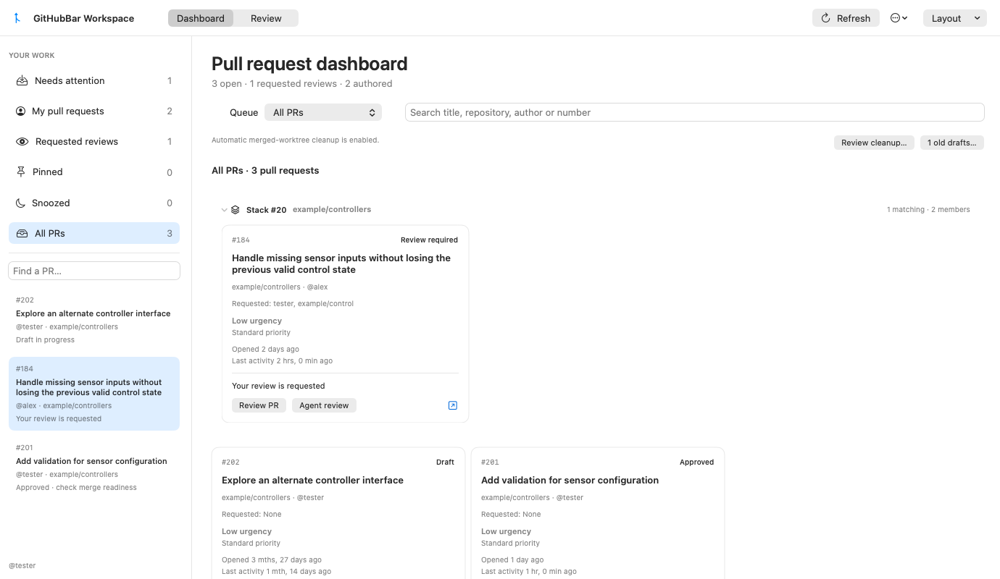
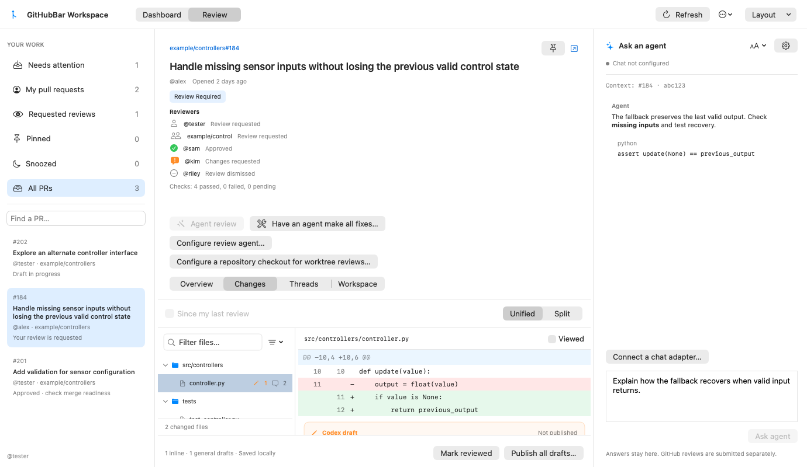
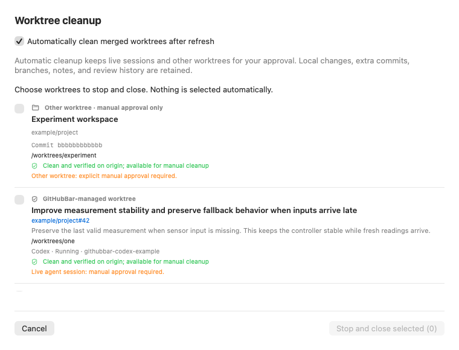
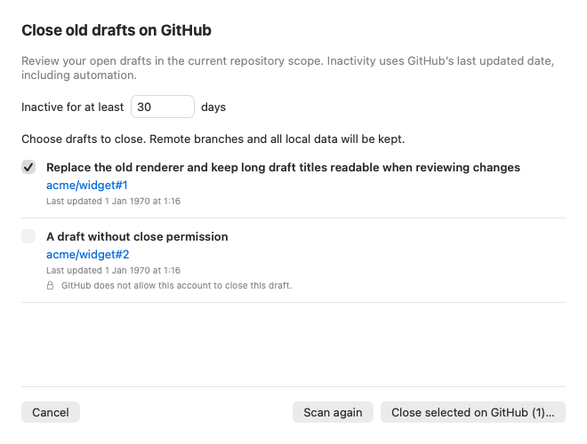
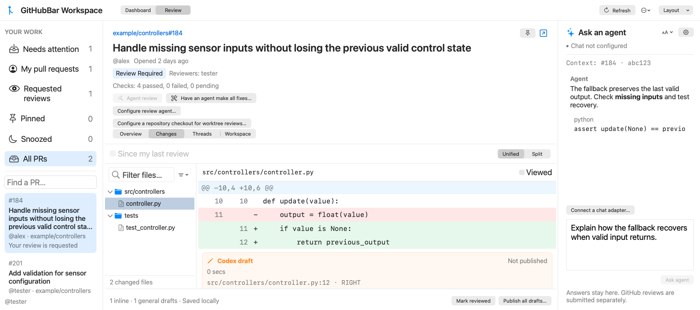
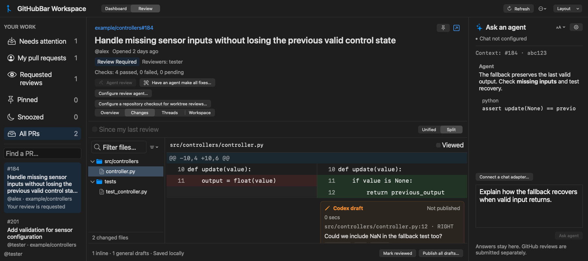
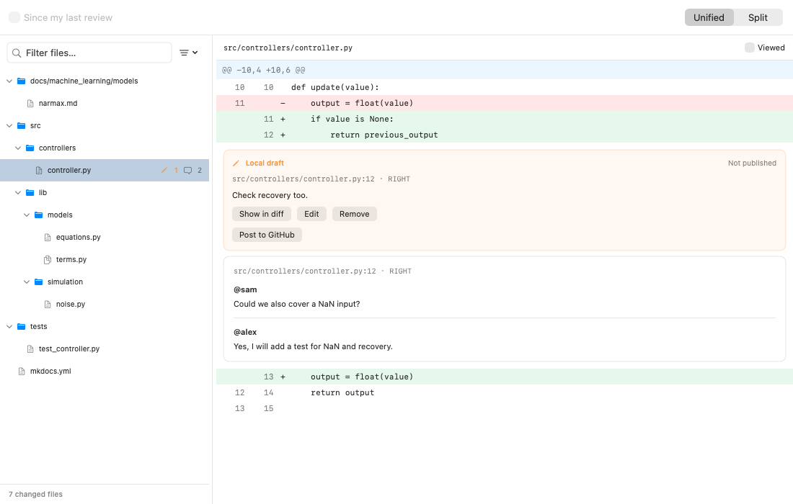
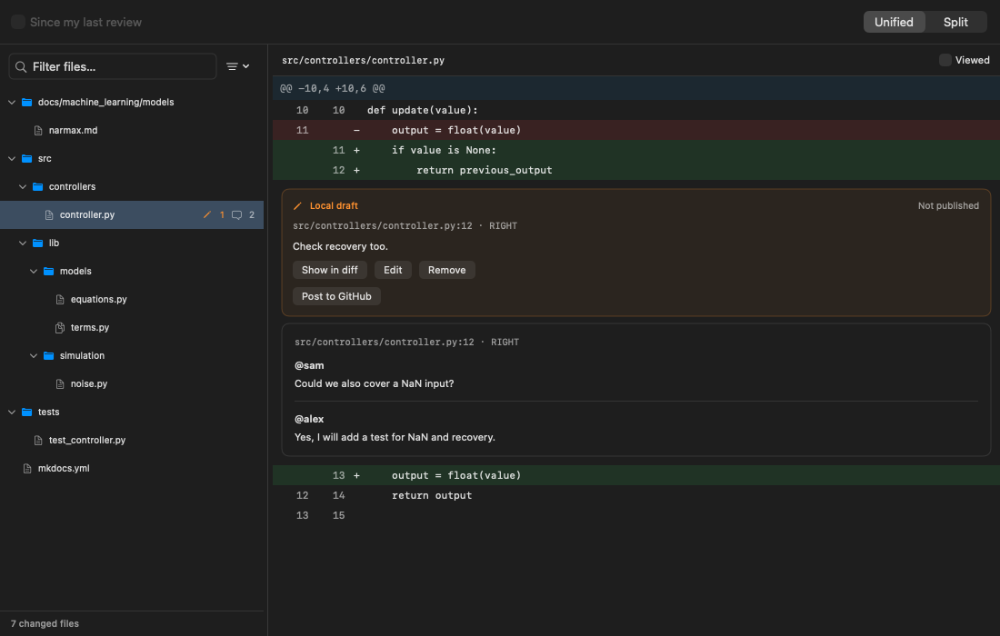

# Workspace improvements: local validation

## PR lifecycle, reviewers, and cleanup (0.10.0)

Design decisions were approved through the fourteen questions captured in
`docs/superpowers/specs/2026-11-05-pr-lifecycle-cleanup-design.md`.

- Authoritative discovery and confirmed terminal-state evidence remove finished PRs
  even during partial metadata refreshes. Incomplete lanes retain unconfirmed rows.
  Closed/merged stack cards are excluded from Dashboard; history links remain in details.
- Full reviewer rows retain effective opinions, completeness and positive request
  evidence. Confirmed approvals tick green; partial requests stay visible without
  implying that an unfetched reviewer has no request. Old cached data still decodes.
- Automatic cleanup runs once per successful refresh, never from restored cache or
  failed refresh, and avoids overlapping manual previews. Only managed, merged,
  clean, exact-remote-head work without live sessions is automatic. Manual external
  cleanup requires clean remote-backed commits and explicit approval. Local branches
  and unrelated terminal sessions stay intact. Local changes include ignored files.
- Old owned drafts use configurable 30-day GitHub updatedAt inactivity. Selection,
  confirmation and fresh account/author/state/head/date/permission checks precede a
  remote close. Remote branches stay intact. Confirmed closes offer manual local cleanup.
- Cleanup history is account-scoped and keeps completed outcomes after cancellation
  or account/config changes. Recent activity is bounded to 20 runs and 200 detailed
  entries per run, with a truncation notice and full summary counts.

Verification on the final source:

- Core: **276 tests, zero failures**, including 51 cleanup and 12 stale-draft tests.
- App harness: **125 tests executed, one skipped, zero failures**: 123 repository app
  tests plus the AppKit bootstrap passed. One native View-menu focus test skips because
  this SwiftPM host cannot make a key window; eight existing PRNavigationTests remain
  excluded for the documented native event-host stall.
- Python adapter fixtures: **34 tests passed**. No provider requests were made.
- `scripts/check.sh` passed: core checks, strict Swift 6/macOS 14 app typechecking,
  avatar/status checks, plist validation and regenerated Xcode project.
- Inspected light/dark dashboard, five reviewer states, external/live/blocked cleanup
  rows, old-draft selection/results at minimum and large sizes, and enlarged-text review.
- Independent task reviews caught and fixed production `user:<login>` identity mismatch,
  lost positive partial-review requests, final-query freshness races, and cancellation
  history loss. Each has red/green regression evidence. Earlier in-flight/parallel runs
  included transient failures; the final complete core run passed, including its
  timing-sensitive process-timeout fixture.
- Whole-branch review also reproduced filter-hidden byte loss and ignored executable
  mode changes. Cleanup now hashes actual tracked file bytes/types/modes against original
  HEAD objects, neutralizes content filters/replacement refs/grafts, and repeats checks
  before ordinary removal. Cached-stat changes and symlink type/target changes have
  fixtures. Verification is bounded to 200,000 entries, 512 MiB per file and 2 GiB total;
  unsupported or oversized trees are retained with a reason.

No live PRs were closed and no user worktrees or sessions were removed or stopped.
Tests use controlled Git repositories, fake CLI sessions, and fake GitHub transports.
Cross-process state cannot be made globally atomic by separate Git/tmux/GitHub checks;
ordinary no-force Git removal and repeated checks retain work when evidence disagrees.
Process checks cover current working directories, not every open file or editor buffer.

Manual checks after installing:

1. Refresh All PRs after merging a disposable PR; its active card should disappear,
   including during unrelated metadata warnings. Review a PR with approved, pending,
   dismissed and team reviewers.
2. Use a disposable managed worktree with its session stopped; refresh and inspect
   **Review cleanup…**. Try dirty, ignored-cache, live-session and extra-commit cases;
   each must remain with a reason. Review an external tree before explicitly removing it.
3. Inspect an old draft's displayed timestamp, select it and review the confirmation.
   Only use a disposable draft for a real close; its branch must remain. A changed
   draft must be retained. Review its local worktree separately.
4. Check native menu focus, window reopening, and the header/agent actions at large text.






## Workspace and chat text sizing (0.9.2)

Cmd+Plus/Cmd+= and Cmd+Minus adjust workspace and chat text together in 10% steps,
from 80% to 200%; Cmd+0 resets both. The native View menu exposes the same actions.
The chat header menu independently sizes Markdown, code, and the native composer.
Both preferences persist. Font changes preserve draft text and selection; active
IME composition defers its font update until unmarking. Diff line heights, gutters,
and horizontal width estimates grow with code text. Large PR headers scroll in a
capped region so the diff remains accessible in the minimum window.

- App harness: 109 tests executed, one explicitly skipped, no failures (107
  repository app tests and the AppKit bootstrap passed). The native View-menu focus
  test skips because this SwiftPM host cannot assign `NSApp.keyWindow`; it remains
  available for a normal app test host. Eight existing PRNavigationTests are still
  excluded for the previously documented native event-host stall.
- Regression checks cover Cmd+Plus/equals/minus/zero with composer focus, saved
  independent sizes and reset, upper/lower limits, invalid stored sizes, draft and
  selection preservation, and IME composition. Native hosted views verify that
  changing the observed preference updates the actual composer font and text.
- `scripts/check.sh` passed: core checks, full strict Swift 6 typechecking,
  avatar/status checks, plist validation, and generated project.
- Inspected light/dark native renders at 160%, chat at 200% in a 900-point window,
  and global 200% at the minimum 900×650 window. Existing normal-size layouts and
  unified/split diff renders also passed. No provider or GitHub writes were needed.

After installing, type an unsent chat draft and use Cmd+Plus, Cmd+Minus, and Cmd+0.
Try the chat header's text-size menu, then reopen the app to check restored sizes.
Check View-menu enablement while switching between workspace and Settings, and
scroll the enlarged PR header at the minimum window size. These live native focus
checks remain manual in this environment.




## Folder tree sidebar (0.9.1)

Changes now groups files by expandable folders with compact directory chains,
path/rename filtering, expand/collapse controls, viewed markers, and local draft
and discussion counts. Selecting a file keeps the existing diff rendering;
external draft/thread navigation reveals its containing folders and clears a
filter that would hide the target. Narrow panels prioritize filenames; counts
remain available in tooltips and accessibility labels.

- 101 repository app tests passed in the SwiftPM app harness, plus its AppKit
  bootstrap test (102 total). Five tree regressions cover branching/compaction,
  collapse, filtering/renames, case-sensitive paths, and file/directory replacement.
- Native renders inspected in light/dark appearances at 1100 points and with a
  140-point sidebar at 600 points. Existing full workspace renders cover 900,
  1380, and 1800-point windows and both diff layouts.
- `scripts/check.sh` passed (core checks, strict app typechecking, avatar/status
  checks, plist validation, and generated Xcode project).
- Eight pre-existing `PRNavigationTests` remain excluded from the temporary app
  harness because its native status/popover event host stalls; they were not
  treated as passing. Live pointer/keyboard interaction still needs a manual check.

Try a PR with nested directories: collapse a folder, filter by filename and by
folder path, clear the filter, select a file, and use a draft's **Show in diff**.
Drag the sidebar divider and check Light/Dark appearances. Confirm the selected
file and its inline drafts remain visible. No real GitHub review was posted.




## Earlier workspace validation

Work branch: `feat/workspace-review-improvements`, based on `03057aa`.
The workspace improvements were merged to main at `5b060ce`; the installation guide followed at `a5a3339`. No real review is posted by the checks.

## Automated checks

- Core suite: 183 tests passed, including review receipts, inline-only reviews,
  invalid/current/comparison coordinates, account/head/base changes, failed and
  ambiguous writes, and grouped root/reply/outdated anchors.
- App suite: 74 tests passed, including the final split-column and native popover
  regressions. The native popover test verifies real refresh publication preserves
  the open popover/hosting tree, controller toggling, and Escape; a visible native
  window supplies the anchor when the test host's status scene has zero height.
- Adapter fixtures: 11 tests passed for Codex/Claude commands, bounded output,
  failures, cancellation, timeout, and protocol/citation validation.
- `scripts/check.sh`: core executable checks, strict Swift 6 app typecheck,
  avatar/menu sizing checks, plist validation, and project generation passed.
- Independent static review: submission version cleanup and service checks reviewed;
  three interaction findings corrected and scoped re-review clean. Approval-policy
  review also caught schema naming, nullable legacy counts, and rules pagination;
  all corrected with regressions and a clean scoped re-review.

The rendered split-column regression first failed when an empty left annotation
collapsed its width; it passes with explicit left/right column containers. Screenshots
were inspected in light/dark appearances at 900, 1380, and 1800 point window widths,
including dashboard stacks, draft cards, grouped replies, and the chat code block.
Updated examples are in `docs/assets/`.

## Explicit agent review and fix actions (2026-11-02)

The follow-up `feat/agent-draft-actions` adds read-only agent reviews imported into
shared local inline/general drafts, individual/all publication, and interactive
fix/test/local-commit sessions in a fresh pinned PR worktree. It also bundles the
generated emerald branch icon. No live provider session or GitHub write was used
for implementation verification.

- Core: **200 tests**, including 12 fix-session and 5 structured-review protocol
  tests. Fixtures verify literal prompt transport, configured permission defaults,
  large private prompt files, checkout/origin and stale-head checks, failed launches,
  real local Git worktrees, legacy chat compatibility, and malformed findings.
- App: **93 tests**, including draft persistence/provenance, both exact diff sides,
  unavailable locations, cancellation/account navigation, duplicate findings,
  read-only review imports, fresh fix context/base changes, individual/batch posting,
  concurrent edits, partial multi-post failures, oversized drafts, user-summary
  validation, and strict UTF-8 context limits.
- Python adapters: **16 tests**, using controlled CLI fixtures only.
- `scripts/check.sh` passed: core executable checks, strict Swift 6 typecheck,
  avatar/menu checks, plist validation, and project generation.
- Final independent review found no actionable issues after fixing location
  preservation, large-batch publishing, and unintended CLI permission overrides.
- Native rendering covers light/dark workspace and fixes sheet, minimum/large
  windows, shared agent draft cards, explicit publishing controls, and chat code.
  Split diffs remain horizontally scrollable when both columns exceed the viewport.

Manual installation checks remain required below. For the new actions, additionally
run **Agent review**, edit/remove findings, publish one while retaining the rest,
and publish all on a disposable PR. Try cancellation and unavailable locations.
Configure a disposable checkout, inspect the fixes prompt, launch Codex/Claude,
and verify its tests and actual local commit in Terminal. Confirm no automatic push.

## Complete worktree agent reviews (2026-11-02)

The `feat/worktree-agent-review` follow-up replaces the app's excerpt review with a
fresh detached checkout at the captured PR head and a complete native
merge-base-to-head manifest. Ordinary chat keeps its bounded context. Findings
still enter the shared local draft store and require explicit publication.

- **Core: 221 tests passed.** New coverage includes full 24-file manifests and
  patches larger than 96 KiB, merge-base baselines, rename/delete/binary/symlink
  entries, wrong origins/commits, shallow/unsafe setup, dirty/replaced artifacts,
  hidden index edits, cancellation after worktree creation, owned process-group
  termination, malicious Git filters, and replacement refs/grafts. A cross-seam
  fixture runs the real manager → Swift client → bundled Python adapter → fake
  Codex CLI, reads every patch/baseline plus full current/surrounding files, returns
  coverage for all 24 paths, and verifies native validation and clean removal.
- **Python: 34 tests passed.** Controlled Codex/Claude fixtures cover native schemas,
  file inventory/identity/permissions, complete and partial coverage, invalid paths,
  symlink escapes, extended deadlines, cancellation and provider failures. Legacy
  chat/excerpt behavior and diagnostic bounds remain covered.
- **App: 95 repository tests passed** in a temporary SwiftPM harness compiling all
  app sources except its application entry point, without Sparkle. An additional
  harness-only test initializes AppKit. This includes 19 agent-action tests for
  native coverage beyond the API snapshot, no excerpt fallback, custom-provider
  guidance, cancelled preparation, validation/missing-coverage failures, draft
  preservation, final commit changes during cleanup, original discussion notices,
  and retained-worktree warnings. Legacy receipt decoding and coverage persistence
  are covered. Eight existing `PRNavigationTests` are excluded from this harness:
  native status/popover creation terminates this test host before completion, even
  though it returns exit status zero. A truncated run is not counted as success.
- `scripts/check.sh` passed: core executable checks, strict Swift 6/concurrency app
  typecheck, avatar/menu sizing checks, plist validation and project generation.
- Native bitmap rendering passed and was visually inspected in light/dark modes
  at 900, 1380 and 1800 points. A partial review is visibly labelled outside the
  receipt disclosure. Updated examples are in `docs/assets/workspace-worktree-review-*`.
- Independent review identified raw Git replacement semantics, a target check
  occurring before awaited cleanup, and lost original input notices. All were
  corrected with focused regression fixtures and a clean final re-review.

No installed provider or private repository content was used for this verification;
the integration uses local Git and controlled CLI fixtures. A real provider's
reported coverage is not proof every line was read or that a PR is defect-free.
The workflow requests inspection only, rejects claimed test execution, and does
not request dependency installs, edits, commits, or GitHub writes.

For installed-build testing, configure the repository checkout/worktree root in
Workspace and choose Codex or Claude. Review a PR with more than six files and a
large patch; compare the manifest denominator to the PR's changed files, inspect
any skipped reasons/limitations, and verify drafts remain local. Try Stop, account
navigation and a changed PR head; no late findings should attach. Clean temporary
trees should disappear; dirty ones should be retained with a visible path. The
native Dock/popover/divider interaction checks below still require a person.

## Approval classification live check

The supplied [carbo PR #12853](https://github.com/carbon-re/carbo/pull/12853) returned
`reviewDecision: null` despite a current eligible approval and an active ruleset
requiring one approval. `mergeStateStatus: DIRTY` reflected conflicts, independently
of approval. With production hydration and the real rules client, a read-only,
single-PR reconciliation now produces `APPROVED`, section `approved`, and preserves
`yuchen-shang` as an outstanding requested reviewer. No GitHub state was changed.

Regression coverage includes one vs two required approvals, current and stale
opinions, dismissal/change requests, eligibility, incomplete review/policy pagination,
legacy nullable counts, explicit GitHub decision precedence, schema field selection,
and stricter later-page rules. Unknown or unsupported extra requirements do not
infer approval. Applicable policy is cached only within each reconciliation.

## Reproduce

Use full Xcode on this Mac:

```bash
export DEVELOPER_DIR=/Applications/Xcode.app/Contents/Developer
export CLANG_MODULE_CACHE_PATH=/tmp/githubbar-clang-cache
export SWIFTPM_MODULECACHE_OVERRIDE=/tmp/githubbar-swift-cache
swift test --disable-sandbox --package-path Packages/GitHubBarCore
xcodebuild test -project GitHubBar.xcodeproj -scheme GitHubBar \
  -destination 'platform=macOS' -derivedDataPath .build/xcode \
  -parallel-testing-enabled NO CODE_SIGNING_ALLOWED=NO
python3 -m unittest discover -s scripts/tests -v
scripts/check.sh
GITHUBBAR_VERSION=0.8.0 scripts/package-validation.sh
```

Within a restricted agent sandbox, Xcode cache access, Swift macro helpers, and the
standard check script may need execution outside the nested sandbox. Core SwiftPM
supports `--disable-sandbox` with the writable cache paths above. A cold SDK statistics
cache can take several minutes before build output resumes.

## Manual checks still required

Computer Use access was unavailable in this session. The following external UI checks
could not be performed; the implementation and native AppKit tests do not substitute
for a person trying them on the installed validation app:

1. Launch the validation app; check Dashboard is selected and GitHubBar appears in
   the Dock and Cmd+Tab. Close its window and click its Dock icon to restore it.
2. Open the status popover, scroll, refresh, and confirm it remains open at the same
   position. Close it with Escape, an outside click, and the status icon.
3. Drag each divider at normal and minimum window sizes. Confirm hover feedback and
   resize cursors. Toggle panels, use Focus diff, reopen, and verify restored widths
   and visibility; Reset layout restores the defaults.
4. Use a real signed-in provider's explicit Test connection, ask a selected-code
   question, cancel and retry. Controlled fixtures cover these paths automatically.
5. On a disposable PR, explicitly post one draft then a batch review. This session
   uses fake transports to cover publishing; it does not perform live GitHub writes.

Legacy worker files, external Giles processes, and the existing installed GitHubBar
were not deleted or terminated. The local validation app is ad-hoc signed and is not
notarized, consistent with the repository's existing validation build workflow.
